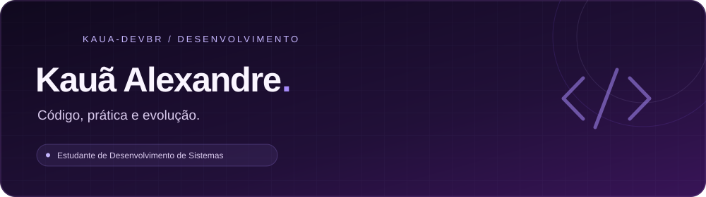
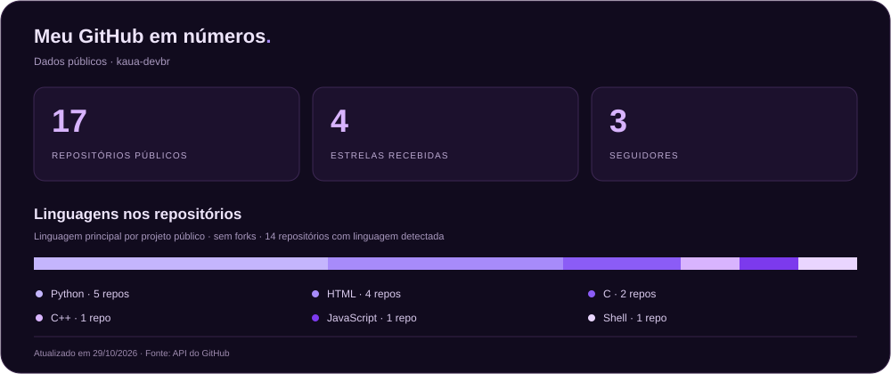

  

  
  

### Um pouco sobre mim

Sou **Kauã Alexandre**, estudante de Desenvolvimento de Sistemas. Aprendo programação construindo projetos e resolvendo exercícios em **C, C++, Python e desenvolvimento web**.

Por aqui, compartilho estudos com visualização gráfica, geração de documentos e interfaces — um projeto de cada vez.

### Estudando atualmente

🌱 **Flask** — aprendendo desenvolvimento web com Python.

### Linguagens que uso nos meus projetos

  

C · C++ · Python · JavaScript · HTML · CSS

### Estatísticas

  

### Estudos e prática

- [Python](https://github.com/kaua-devbr/Python): exercícios de programação e fixação de conceitos.
- [C](https://github.com/kaua-devbr/C): exemplos, projetos e testes.
- [Todos os repositórios](https://github.com/kaua-devbr?tab=repositories): outros projetos e experimentos.

---

Aprender. Construir. Evoluir. <a href="https://github.com/kaua-devbr">@kaua-devbr</a>

